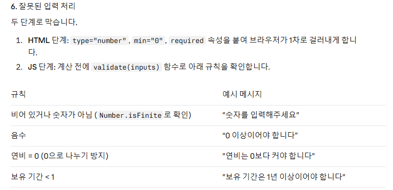
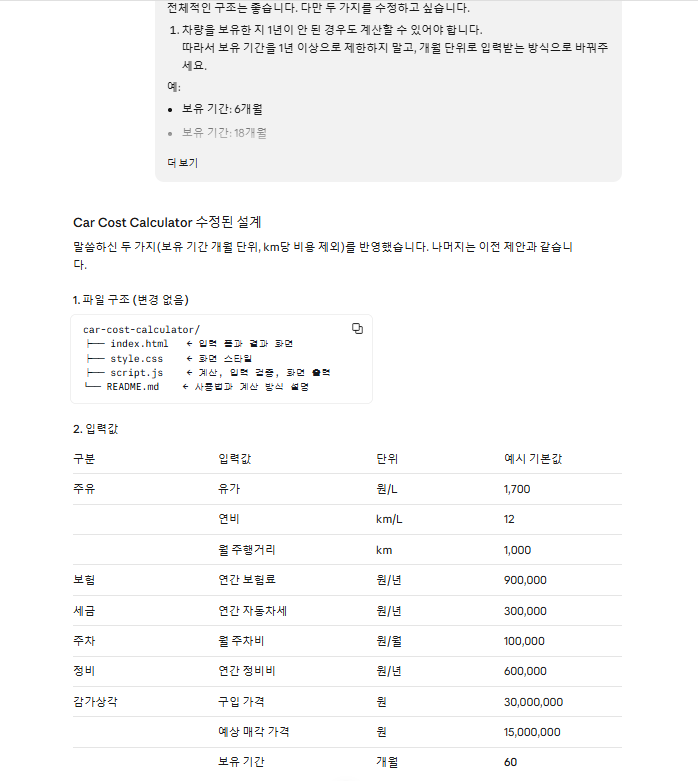
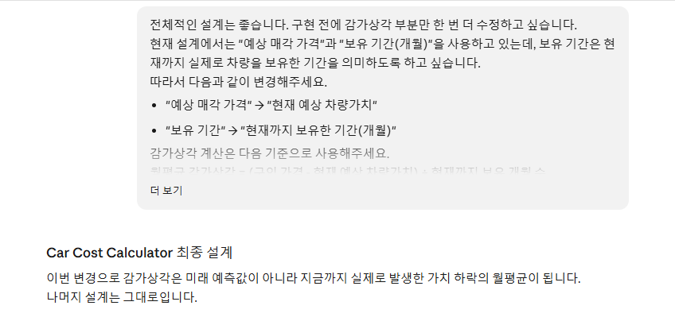
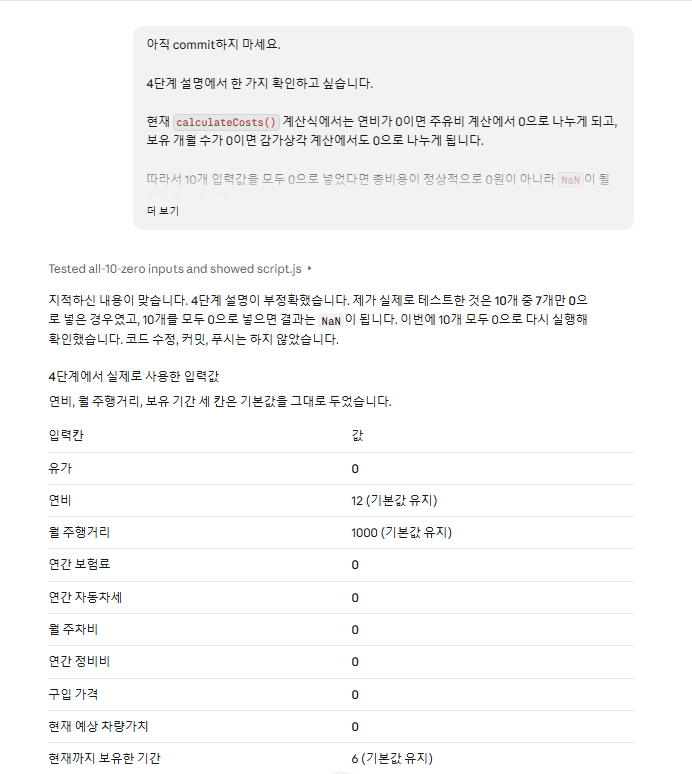
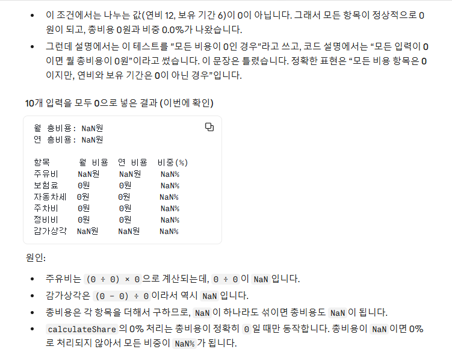
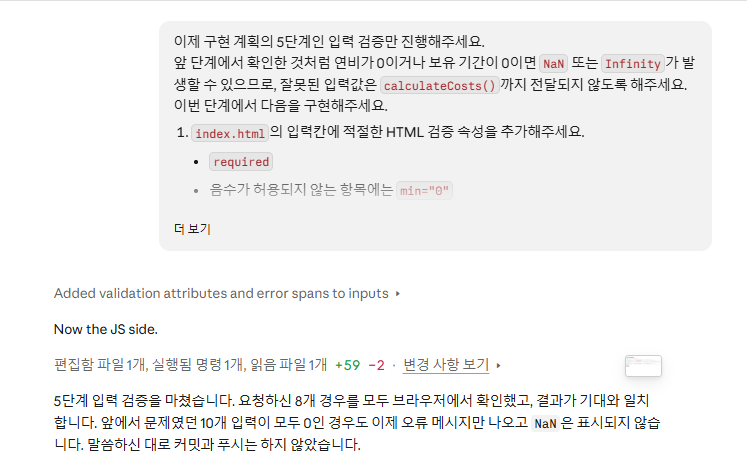

# Car Cost Calculator

## 1. Purpose and Intended Users

Car Cost Calculator helps car owners see roughly what owning a car costs per month and per year by combining fuel, insurance, car tax, parking, maintenance, and depreciation into an estimated car ownership cost.

Main features:

- Estimated monthly and yearly total ownership cost
- Amount and share (%) of each cost item
- Base Scenario A vs. Scenario B, which changes fuel price and monthly mileage

## 2. How to Run and Use

This static web app uses only HTML, CSS, and JavaScript; no installation or build step is needed.

1. Open `index.html` in a browser.
2. Enter costs (example values are pre-filled).
3. Click `계산하기` (Calculate) to see monthly and yearly totals and each item's cost.
4. In Scenario B, change only fuel price and monthly mileage and recalculate to compare each item with Scenario A.

Insurance, car tax, and maintenance are yearly inputs; parking is monthly. Depreciation is the average monthly depreciation: `(purchase price − current estimated vehicle value) ÷ months owned so far`.

## 3. Work Process

I worked in steps rather than all at once:

1. HTML input form and result area
2. `calculateCosts()` function
3. Connecting inputs, the calculate button, and results
4. Cost and share of each item
5. Input validation and error handling
6. Fuel price and monthly mileage scenario comparison
7. Responsive styling
8. Final verification

Before implementation, I reviewed Claude Code's proposed design and changed the ownership period unit and depreciation basis myself. For step 1, Claude Code committed first and I reviewed the code afterward. From step 2 onward, I followed "write code → review full code → check browser test results → commit," leaving each step in the Git history.

## 4. Selected Claude Code Evidence and Verification Results

### Selected Claude Code examples

**Example 1: Ownership period in months**

Claude Code's initial design took the ownership period in years with a minimum of 1 year, so cars owned under a year could not be calculated. I changed the input to months.

*Claude Code's initial design required an ownership period of at least 1 year. I asked for month-based input so cars owned for less than a year could be calculated, and the design was revised.*

**Example 2: Revising the depreciation basis**

The initial design used an `expected resale price` and an `ownership period`. Reviewing it, I found that if the period means "owned so far," its time basis does not match a future resale price, so I redefined the inputs:

- Expected resale price → current estimated vehicle value
- Ownership period → months owned so far

*I changed the depreciation inputs from an expected resale price and ownership period to the current estimated vehicle value and months owned so far.*

**Example 3: Reviewing the zero-input test explanation and the NaN problem**

In step 4, Claude Code said "if all inputs are 0, the monthly total becomes 0 won." However, the formulas divide by zero if fuel efficiency or ownership period is 0. Asking for the test conditions showed those two had stayed at defaults, with only the other 7 inputs set to 0. With all 10 inputs at 0, the page displayed `NaN원`. Step 5 validation requires fuel efficiency above 0 and an ownership period of at least 1 whole month, so invalid values never reach `calculateCosts()`. A retest with the same inputs confirmed the fix.

*After I questioned the zero-input test, Claude Code confirmed that the original test had not set all inputs to 0. Retesting showed NaN원, and step 5 input validation then blocked the invalid input.*

### Final verification

Representative calculation results were compared with hand-calculated values. Final verification covered 25 items across features, input validation, layout, and the console, with no code changes. All passed.

| Type | Input | Result |
|---|---|---|
| Normal | Defaults | KRW 1,058,333/month, KRW 12,700,000/year, depreciation 63.0% |
| Normal | B mileage 1,000 → 2,000 km | +KRW 141,667/month, +KRW 1,700,000/year, other 5 items unchanged |
| Normal | B fuel price 1,700 → 2,000 KRW/L | +KRW 25,000/month, +KRW 300,000/year |
| Edge case | Fuel efficiency 0, ownership period 0 | Error message, no calculation, no `NaN`/`Infinity` |
| Edge case | Empty input | Error message (please enter a number), not treated as 0 |
| Invalid input | Current value > purchase price | Error message (current value cannot exceed purchase price), no calculation |

Other checks included a 6.5-month ownership period, a negative cost, and empty or negative Scenario B values. Scenario A errors showed no result; errors only in Scenario B kept the A result and hid only the comparison. Correcting the value and recalculating cleared the error display. Chromium viewports of 1280px (desktop) and 375px/320px (mobile size) showed no cut-off inputs or buttons; tables scrolled horizontally on narrow screens. Console errors and warnings: 0.

## 5. Three Effective Practices

1. **Building step by step.** Going HTML → calculation → output → validation → comparison → styling meant less code to check at once and made problems easier to trace to a step.
2. **From step 2 onward, I reviewed the code and test results at each step before committing.** Through this flow, I also found the Example 3 problem before committing step 4.
3. **Not taking Claude's explanations at face value.** Comparing hand calculations, the actual code, and test results is how I found the NaN problem in Example 3.

## 6. Three Difficulties

1. **Cars owned under a year**
   - Problem: With the period in years, these cars could not be calculated.
   - Check: Periods like 6 or 18 months could not be expressed.
   - Response: I changed the ownership period to months.
2. **Time basis of depreciation**
   - Problem: An expected resale price (future) and the period owned so far (present) had different time bases.
   - Check: I confirmed this while reviewing the design.
   - Response: I redefined depreciation using the current estimated vehicle value and months owned so far.
3. **Incorrect values from division by zero**
   - Problem: A fuel efficiency or ownership period of 0 divides by zero; with all inputs at 0, `NaN원` was displayed.
   - Check: I checked the formulas and test conditions to find the cause.
   - Response: Input validation was added so invalid values do not reach the calculation function, and the same inputs were retested.

## 7. Known Limitations

- Depending on changes in the current vehicle value, the average monthly depreciation may not represent the long-term ownership cost.
- Car tax must be entered manually; it is not calculated from engine size or vehicle age.
- EV charging, loan or installment interest, tolls, car washes, and similar costs are not included.
- Only fuel price and monthly mileage can be changed in the scenario comparison.
- Browser verification was done only in Chromium, not in Safari, Firefox, or on an actual phone.

## 8. Key Source Files for Grading

- `index.html`: input form (Scenarios A and B), calculate button, and result areas
- `script.js`: cost calculation (`calculateCosts`), input reading and validation, result and comparison tables
- `style.css`: layout, error display, difference colors, and mobile support
